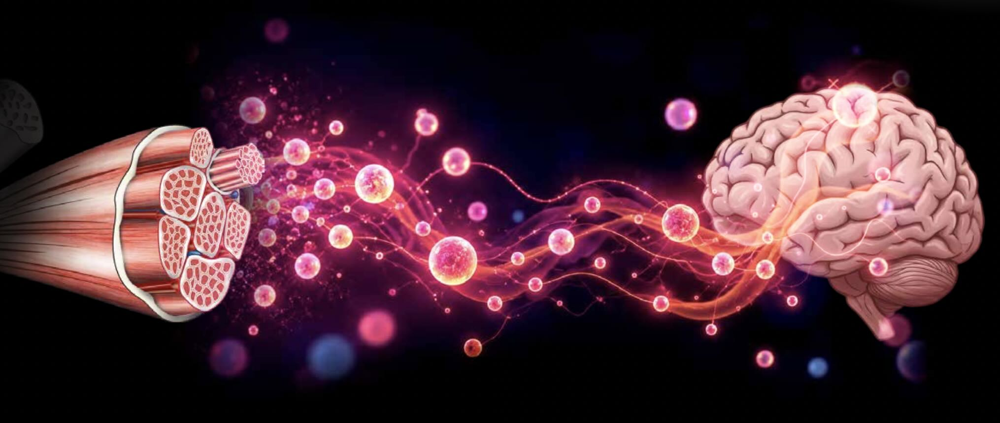

---
title: "Oportunidades no meu laboratório: iniciação científica, mestrado e doutorado"
summary: Estamos recrutando em todos os níveis, iniciação científica, mestrado e doutorado, com início imediato e bolsa disponível, para investigar como o exercício físico protege o cérebro.
authors: [admin]
tags: [recrutamento, CRISPR, neurociência molecular, biologia molecular, pós-graduação]
categories: [anuncios]
date: 2026-10-24
featured: true
draft: false
math: false
diagram: true
highlight: true
---

## Venha fazer ciência com a gente!

**Estamos recrutando estudantes e pesquisadores em formação para início imediato, com disponibilidade de bolsa!**

Nosso grupo de pesquisa, localizado em **São Paulo**, integra o programa [Ciência Pioneira](https://cienciapioneira.org/) e desenvolve projetos no Instituto D'Or de Pesquisa e Ensino (IDOR) - Unidade Brigadeiro L Antônio 5001.

Buscamos pessoas interessadas em **iniciação científica, mestrado ou doutorado**, com diferentes níveis de experiência, para participar de projetos na interface entre biologia molecular, neurociência, edição epigenética, e desenvolvimento de ferramentas moleculares e novas estratégias terapêuticas.

**Há possibilidade de ingresso imediato como estagiário(a) de pesquisa remunerado(a), mas informal**, com perspectiva de continuidade no grupo e candidatura ao Programa de Pós-Graduação em Ciências Médicas do IDOR no próximo processo seletivo, conforme os requisitos e critérios de admissão do programa.

### Como o exercício físico protege o cérebro?

Essa é uma das perguntas que orientam nossas pesquisas.

Embora a atividade física esteja associada a benefícios para a saúde cerebral, muitos dos mecanismos moleculares envolvidos nessa proteção ainda não são completamente compreendidos.

Investigamos como sinais produzidos pelo músculo podem influenciar a expressão gênica, promover a resiliência neuronal e contribuir para a proteção contra doenças neurodegenerativas, como a doença de Alzheimer.

Para responder a essas perguntas, combinamos tecnologias CRISPR, edição epigenética, modelos celulares humanos e análises genômicas e transcritômicas.

### O que pesquisamos?

Nossas principais linhas de investigação incluem:

- **CRISPR e edição epigenética:** desenvolvimento e aplicação de ferramentas para modular a expressão gênica e investigar mecanismos moleculares.
- **Neuroproteção e doença de Alzheimer:** identificação de genes, fatores neuroprotetores e mecanismos associados à resiliência neuronal.
- **Comunicação músculo-cérebro:** investigação de sinais moleculares associados ao exercício físico e seus potenciais efeitos sobre a saúde cerebral.
- **Biologia molecular e celular:** utilização de células humanas, modelos neuronais e técnicas experimentais para investigar processos biológicos.
- **Bioinformática e genômica:** análise de dados transcriptômicos e outras abordagens ômicas para identificar mecanismos e vias moleculares relevantes.

### Quem estamos procurando?

As oportunidades são destinadas a estudantes e profissionais em diferentes etapas de formação:

- **Iniciação científica:** estudantes de graduação interessados em iniciar sua trajetória em pesquisa.
- **Mestrado:** graduados ou estudantes em fase de conclusão da graduação interessados em desenvolver um projeto científico.
- **Doutorado:** mestres ou profissionais com formação compatível interessados em desenvolver pesquisa em neurociência molecular e biotecnologia.

São bem-vindas pessoas de Ciências Biológicas, Biomedicina, Biotecnologia, Química, Bioquímica, Farmácia, Neurociências, Bioinformática e áreas relacionadas.

**Não espero que você já domine todas as técnicas.** Para iniciação científica, não espero experiência prévia com nenhuma delas, espero curiosidade e vontade de aprender. 
Para mestrado e doutorado, alguma vivência em biologia molecular e celular é desejável, mas o que pesa mais é a disposição de aprender da bancada à bioinformática.

**Valorizamos curiosidade científica, pensamento crítico, dedicação, iniciativa e vontade incessante de aprender.**

### Bolsa e início das atividades

**Temos disponibilidade de bolsa para início imediato das atividades de pesquisa em São Paulo.**

A proposta é oferecer uma oportunidade de integração ao laboratório, com participação em projetos científicos, treinamento em técnicas experimentais e desenvolvimento de habilidades em pesquisa.

Para candidatos interessados em mestrado ou doutorado, essa etapa poderá funcionar como um período inicial de pesquisa remunerada, com possibilidade de desenvolvimento de um projeto e posterior candidatura ao **Programa de Pós-Graduação em Ciências Médicas do IDOR**, no próximo processo seletivo.

A continuidade na pós-graduação dependerá da aprovação no processo seletivo e do cumprimento dos requisitos institucionais.

### Como se candidatar?

Se você tem interesse em fazer parte do nosso grupo, envie um e-mail contendo:

1. Uma breve apresentação pessoal e seus interesses científicos.
2. Seu currículo acadêmico ou Currículo Lattes.
3. Seu nível atual de formação e interesse em iniciação científica, mestrado ou doutorado.
4. Uma breve explicação sobre por que gostaria de participar das nossas pesquisas.

**E-mail:** [thyago.calvo@idor.org](mailto:thyago.calvo@idor.org)

**Assunto:** Interesse em pesquisa no Lab IDOR/Ciência Pioneira – Seu nome

---

**A ciência começa com boas perguntas.**

Se você gosta de desafios, tem curiosidade sobre como os genes funcionam e quer contribuir para a compreensão dos mecanismos moleculares da saúde e da doença, entre em contato!

*Compartilhe esta oportunidade com quem possa se interessar.*